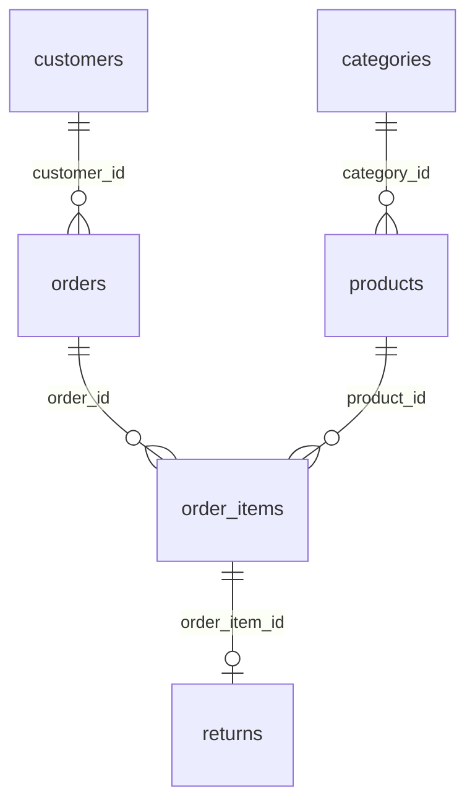

# E-commerce Dataset — Schema, Relationships and Generation Notes

This dataset is a synthetic Indian e-commerce dataset expanded from the original 6-table source (`kaggle_dataset/`). The final files in this folder deliberately contain data-quality problems. `clean_reference/` holds the same data before those problems were added.

## Files

| File | Rows | Status |
|---|---|---|
| `customers.csv` | 30,000 | expanded (5,000 original + 25,000 new), dirty |
| `orders.csv` | 100,000 | expanded (9,000 original + 91,000 new), dirty |
| `order_items.csv` | 165,190 | expanded (15,000 original + 148,071 new = 163,071 clean, + 2,119 injected duplicate rows), dirty |
| `returns.csv` | 20,000 | expanded (1,500 original + 18,500 new), dirty |
| `products.csv` | 300 | **unchanged** — byte-for-byte copy of the original |
| `categories.csv` | 6 | **unchanged** — byte-for-byte copy of the original (this is the "Product Category" table) |
| `clean_reference/*.csv` | same | ground-truth clean version of every table |
| `data_quality_issue_log.csv` | ~50k | one line per injected issue: table, row_number, key, column, issue_type, clean_value, dirty_value |
| `data_quality_report.md` / `.json` | — | rule-based validation results |

## Entity-relationship model



The schema is a classic order-line model. A customer places orders, and each order has 0..n line items. Each line item references one product, and each product belongs to one category. A return refers to one order line, and each line has at most one return in the clean data.

## Table schemas

Types are the logical types as they appear in `clean_reference/`. The dirty files are meant to be read as text.

### customers — PK `customer_id`
| Column | Type | Notes |
|---|---|---|
| customer_id | int | 1–30000, unique |
| name | string | "First Last" |
| email | string | lowercase, `@example.com/.org/.net` |
| **phone_number** | string | **new.** Canonical format `+91-XXXXXXXXXX`; the 10-digit mobile number starts with 6–9 |
| signup_date | date `YYYY-MM-DD` | |
| city | string | one of the 83 cities in the original data |
| state | string | one of 28 Indian states |
| **region** | enum | **new.** `NORTH`/`SOUTH`/`EAST`/`WEST`, derived from `state` (see mapping below) |

### orders — PK `order_id`, FK `customer_id → customers`
| Column | Type | Notes |
|---|---|---|
| order_id | int | 1–100000 |
| customer_id | int | FK |
| **order_date** | date `YYYY-MM-DD` | **new.** `signup_date ≤ order_date ≤ 2026-11-14` |
| order_status | enum | `Delivered`, `In Transit`, `Canceled` |
| payment_method | enum | `Cash on Delivery`, `Net Banking`, `UPI`, `Loyalty Points` |

### order_items — PK `order_item_id`, FKs `order_id → orders`, `product_id → products`
| Column | Type | Notes |
|---|---|---|
| order_item_id | int | |
| order_id | int | FK |
| product_id | int | FK |
| **sku** | string | **new.** `<CAT>-<NAME>-<NNNN>` e.g. `ELE-SPH-0004` (see below) |
| quantity | int | 1–5 |
| unit_price | decimal(2) | equals `products.price` in clean data |

### returns — PK `return_id`, FK `order_item_id → order_items`
| Column | Type | Notes |
|---|---|---|
| return_id | int | 1–20000 |
| order_item_id | int | FK; only items of `Delivered` orders |
| return_date | date `YYYY-MM-DD` | **corrected.** `order_date + 1..30 days`, never after the snapshot |
| refund_amount | decimal(2) | `quantity × unit_price`, or a partial-quantity refund (see below) |

### products — PK `product_id`, FK `category_id → categories` (unchanged)
`product_id, product_name, category_id, price, cost_price`

### categories — PK `category_id` (unchanged)
`category_id, category_name`

## Derived-column rules

**Region (state → region)**
- NORTH: Haryana, Himachal Pradesh, Punjab, Rajasthan, Uttar Pradesh, Uttarakhand
- SOUTH: Andhra Pradesh, Karnataka, Kerala, Tamil Nadu, Telangana
- EAST: Arunachal Pradesh, Assam, Bihar, Chhattisgarh, Jharkhand, Manipur, Meghalaya, Mizoram, Nagaland, Odisha, Sikkim, Tripura, West Bengal
- WEST: Goa, Gujarat, Maharashtra, Madhya Pradesh

The requirement only allows four regions, so the central states are folded into the nearest of the four: Chhattisgarh goes to EAST and Madhya Pradesh to WEST. The North-East states are in EAST. Region is derived from *state*, not city, because one city name, Udaipur, exists in both Rajasthan and Tripura.

**SKU.** `products.csv` must stay unchanged, so the SKU lives on `order_items`. It is computed deterministically from the product:
- category code: 1 `APP` Apparel/Fashion, 2 `ELE` Electronics, 3 `BEA` Beauty/Cosmetics, 4 `HKF` Home & Kitchen Furniture, 5 `FNB` Food & Beverages, 6 `TOY` Toys
- product-name code: Smartphone `SPH`, Laptop `LAP`, Wireless earbuds `WEB`, Bluetooth speaker `BTS`, Smartwatch `SWT`, Running shoes `RSH`, T-shirt `TSH`, Backpack `BPK`, Perfume `PRF`, Coffee maker `CFM`, Office chair `OFC`, Bedsheets `BDS`, Gaming mouse `GMS`, Printer `PRT`, Water bottle `WBT`
- 4-digit zero-padded product_id

Because the SKU encodes the product_id, it is unique per product. To rebuild a product → SKU lookup table, run `make_sku()` in `scripts/common.py`.

## How the data was expanded (clean stage, `scripts/02_expand.py`)

- **Original rows are preserved.** All 5,000 / 9,000 / 15,000 / 1,500 original rows keep their IDs and values in `clean_reference/`. The only change is the new columns, plus the corrected `return_date`. New IDs continue from the original maximum.
- **Snapshot date:** 2026-11-15. No order, return or signup in the clean data falls after it.
- **New customers:** names are recombined from first and last names found in the original customers. Emails follow similar patterns and are unique. Signup dates run from 2023-01-01 to 2026-10-31, weighted towards recent dates to show growth. State is picked uniformly and then a city within that state, the same way the original generator did it. The region mix is therefore EAST-heavy, because 13 of the 28 states are eastern or north-eastern.
- **Order dates** are generated for *all* orders, original ones included, because the source had none. The date range depends on status:
  - `Delivered`: between signup and the snapshot minus 5 days
  - `Canceled`: between signup and the snapshot minus 1 day
  - `In Transit`: within the last 30 days before the snapshot
  - New order IDs are assigned in date order.
- **New orders:** the status mix is 80% Delivered, 17% Canceled and 3% In Transit. This differs from the original's roughly equal thirds, which would mean an unrealistic return rate and a huge in-transit backlog. Payment methods stay uniform, as in the original. Customer order frequency is skewed (log-normal) and scaled by how long the customer has been active.
- **New order items:** each order has 1–4 lines (55/28/12/5%). 15% of new Canceled orders have no lines, which is consistent with the 1,658 original orders that have no lines. Product popularity is mildly skewed. Quantity runs from 1 to 5, weighted towards 1. `unit_price` equals `products.price`.
- **Returns:**
  - **Fixing the original return dates:** every one of the 1,500 original `return_date` values was the same day, 2026-02-20, which was an artefact of the original generator. They are regenerated as `order_date + lag`. The lag follows a Gamma distribution, clipped to 1–30 days (median about 7) and capped at the snapshot.
  - **New returns:** the 18,500 new returns are sampled without replacement from Delivered order items, at most one per item. 88% are full refunds (`quantity × unit_price`) and 12% are partial-quantity refunds for lines with quantity > 1.
- **Reproducibility:** all randomness comes from `numpy.random.default_rng(20261117)` (`SEED` in `scripts/common.py`), and the injection stage uses seed+1. Rerunning the pipeline produces byte-identical outputs.

## Data-quality issues (dirty stage, `scripts/03_inject_issues.py`)

Each issue type affects a small, fixed share of rows, between about 0.1% and 4% depending on the issue. The share of rows with at least one issue is about 21% for customers, 17% for orders, 13% for order_items and 15% for returns. Every injected change is in `data_quality_issue_log.csv`, with its clean value.

| Category | Examples |
|---|---|
| Exact duplicates | Full-row copies: 300 customers, 1,000 orders, ~1,630 order_items, 200 returns |
| Duplicate key, conflicting values | Same PK with one field changed (email/phone/city, status/payment/date, quantity, refund) |
| Duplicate entity | The same person under two `customer_id`s (150 cases); the same item returned under two `return_id`s (100 cases) |
| NULLs | Mostly empty cells, plus `NULL`, `null`, `N/A`, `NaN`, `none` and `-` tokens |
| Inconsistent formatting | Mixed date formats (`05/03/2026`, `Mar 05, 2026`, `20260305`, ...); phone formats (`09876543210`, `+91 98765 43210`, ...); upper/lower case and stray spaces; status and payment variants (`delivered`, `Cancelled`, `COD`, `Netbanking`); legacy city names (Bombay, Madras, ...); state abbreviations and misspellings (`MH`, `Tamilnadu`, `Orissa`); SKU variants (`ele-sph-0004`, `ELESPH0004`); currency strings (`₹12,345.67`, `Rs. 123.00`) |
| Invalid values | Malformed emails and phones; regions outside the allowed four; unknown statuses or payment methods; quantity of 0, negative, 999 or `two`; zero or negative prices and refunds; malformed SKUs |
| Inconsistent values | Region that doesn't match the state; SKU for the wrong product; unit_price different from the list price; refund larger than the line value; return on a non-Delivered order |
| Incorrect dates | Future dates (2027+); placeholders (1900-01-01, 1970-01-01); impossible dates (2025-02-30); order before signup; return before order; returns more than 30 days after the order |
| Broken foreign keys | About 0.8% of orders→customers, 0.5% of items→orders, 0.4% of items→products and 0.6% of returns→items |

**Safeguards**
- **Row counts:** customers, orders and returns must keep exact row counts. Their duplicates therefore *replace* existing rows ("victims") instead of being added. Victims are always newly generated rows with **no child records**: customers with no orders, orders with no lines, or returns. Original rows are never replaced, and no foreign key is broken by accident. The only broken links are the deliberate ones in the table above.
- **Original rows** can receive cell-level noise at the same rates as new rows, so you can't tell clean from dirty by ID range. Their true values remain in `clean_reference/`.
- **Products and categories** are never parsed and rewritten, only copied as files. This is checked with SHA-256 and a byte comparison against `kaggle_dataset/`.

## Notes for interpreting the report

- Cross-table rules can find more violations than were injected for that rule. For example, corrupting `orders.order_date` also creates "return before order" or "return more than 30 days" violations for that order's returns. Likewise, corrupting `order_items.quantity` or `unit_price` can make a correct refund look too large. Read `data_quality_issue_log.csv` for the root causes.
- 22 email addresses (44 rows) already appeared on two different customers in the *original* file. These come from the original Faker generator and were kept as-is. They are the only findings in the clean-reference control.
- When a key is duplicated, cross-table lookups use the first occurrence.

## Assumptions

1. **Source location:** there was no ZIP in `input/`. The source CSVs were in `kaggle_dataset/`, so `scripts/01_inspect.py` packs them into `input/original_dataset.zip` and the pipeline works only from that copy. `kaggle_dataset/` is never written to. If a ZIP is placed in `input/`, it is used instead.
2. **Product Category** is `categories.csv`.
3. **Column names:** new columns use the existing snake_case convention: `order_date`, `phone_number`, `region` and `sku`.
4. **Row counts for supporting tables:** only customers, orders and returns had row-count targets. `order_items` was expanded to keep about 1.7 lines per order.
5. **Region** applies to customers, because it depends on the customer's state. It is not copied onto orders; get an order's region by joining orders to customers. SKU applies to order lines, because products could not be changed.
6. **Date format:** dates are calendar dates without times, matching the original `signup_date` and `return_date`.

## Reproducing

```
python scripts/run_pipeline.py      # or run 01..04 individually
```
