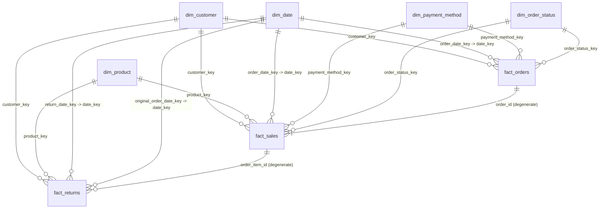

# Gold Star Schema

All objects are in `{retail.catalog}.gold` and are materialized views defined in `gold.py`.

## Diagram



```
                         dim_date (date_key YYYYMMDD)
                                   │
   dim_customer ──┐                │                ┌── dim_payment_method
   (customer_key) │                │                │   (payment_method_key)
                  ├──── fact_sales (order_item_id) ─┤
   dim_product ───┤          │          │           └── dim_order_status
   (product_key)  │          │          │               (order_status_key)
                  │   order_id│          │order_item_id
                  │          ▼          ▼
                  │   fact_orders   fact_returns (return_id) ── dim_date ×2
                  └──────────────────────┘
```

## Grains and keys

| Table | Grain | Primary key | Foreign keys |
|---|---|---|---|
| `dim_date` | one calendar day, plus Unknown (-1) | `date_key` (INT, YYYYMMDD) | – |
| `dim_customer` | one current Silver customer, plus Unknown (-1) | `customer_key` (BIGINT) | `signup_date_key` → `dim_date` |
| `dim_product` | one current Silver product with its category, plus Unknown (-1) | `product_key` (BIGINT) | – |
| `dim_payment_method` | one payment method, plus Unknown (-1) | `payment_method_key` (BIGINT, fixed 1–4) | – |
| `dim_order_status` | one order status, plus Unknown (-1) | `order_status_key` (BIGINT, fixed 1–3) | – |
| `fact_sales` | one order line (`order_item_id`) | `order_item_id` | `customer_key`, `product_key`, `order_date_key`, `payment_method_key`, `order_status_key` |
| `fact_orders` (supporting) | one order (`order_id`), including orders without lines | `order_id` | `customer_key`, `order_date_key`, `payment_method_key`, `order_status_key` |
| `fact_returns` | one return record (`return_id`) | `return_id` | `customer_key`, `product_key`, `return_date_key`, `original_order_date_key`; `order_item_id` → `fact_sales` |

**Business keys** (`customer_id`, `product_id`, `order_id`, `order_item_id`, `return_id`) are kept on every table for traceability back to Silver and Bronze. The facts also carry lineage columns: `*_row_hash`, `*_source_file` and `*_ingested_at`.

## Key definitions

| Key | Definition | Why |
|---|---|---|
| `customer_key` | `xxhash64('customer', customer_id)` | Deterministic, so the key never changes across refreshes or a full refresh. No key table or MERGE state is needed. |
| `product_key` | `xxhash64('product', product_id)` | Same reasoning as `customer_key` |
| `date_key` | `year*10000 + month*100 + day` | Readable, and sorts by date |
| `payment_method_key`, `order_status_key` | Fixed constants in `gold.py` | Small, documented domains |
| Unknown member | `-1` in every dimension | Used when a key cannot be resolved; never silently dropped |

Collision safety is checked in `GOLD_VALIDATION.sql` §1–2: keys are unique, equal the hash formula, and are never `-1`. `monotonically_increasing_id()` is not used anywhere.

## Join paths

| Question | Join path |
|---|---|
| Sales by anything | `fact_sales` → `dim_*` on the surrogate keys. Filter `is_revenue_eligible` for sales KPIs (excludes Canceled). |
| Order counts, AOV, payment mix, cohorts | `fact_orders`, which has one row per order. Filter `is_sales_order` (not Canceled, has lines). **Do not** count orders from `fact_sales` without `COUNT(DISTINCT order_id)`. |
| Returns by product or customer | `fact_returns` → `dim_product` / `dim_customer`. The keys are copied from the original sale. |
| Return rate | `COUNT(DISTINCT fact_returns.order_item_id WHERE is_sale_revenue_eligible)` / `COUNT(fact_sales.order_item_id WHERE is_revenue_eligible)`. Aggregate each side first, then join on the dimension key to avoid fan-out. |
| Time | `order_date_key`, `return_date_key` or `original_order_date_key` → `dim_date.date_key`. Use `year_month`, `year_quarter`, `month_start` or `quarter_start`. |
